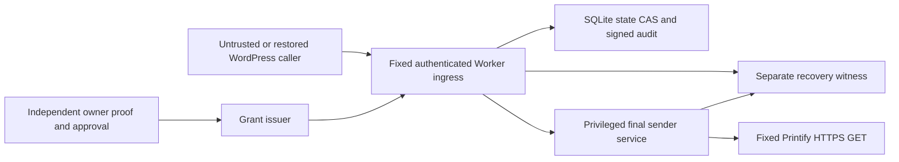

# Printify Cloudflare dispatcher — offline implementation

**IMPLEMENTED_OFFLINE / TESTED_SYNTHETIC. NOT DEPLOYABLE.**
No Cloudflare resource, credential, production configuration or live provider call
is used. The default Worker returns503 unless supplied a programmatic synthetic
runtime instance. Serialized environment flags cannot construct that instance.
There is no deployment configuration, production factory, live witness backend,
real credential adapter, enabled WordPress bridge or automatic activation path.

## Implemented boundary

The physical sender owns credential use and response minimization. It is not a
Boolean permission returned to WordPress. In tests its fetch and custody are
synthetic only. Its private fields do not expose raw credentials or responses to
the Worker. A future real sender/witness must be independently administered and
outside the WordPress AND rollbackable Worker credential boundary. A Worker that
retains a usable token can bypass cooperative policy after a code rollback; this
implementation does not claim that JavaScript private fields or a code-hash field
alone prevent a privileged deployment/secret administrator doing so.

## Source map and capability disposition

| Component | Source | Qualification |
|---|---|---|
| Fixed canonical schemas, Ed25519, bindings | protocol.mjs | IMPLEMENTED_OFFLINE / TESTED_SYNTHETIC |
| Frozen GET grammar, all24 PHP operation IDs | allowlist.mjs | TESTED_SYNTHETIC; full PHP parity tested |
| Cloudflare sql.exec / transactionSync adapter | sqlite-state.mjs | IMPLEMENTED_OFFLINE; real local SQLite tests; hosted INFRASTRUCTURE_UNVERIFIED |
| Independent proof/approval issuer | issuer.mjs | IMPLEMENTED_OFFLINE; live identity/signing administration unqualified |
| Reservation/admission/drain coordinator | runtime.mjs | IMPLEMENTED_OFFLINE / TESTED_SYNTHETIC |
| Final physical service boundary | sender.mjs | TESTED_SYNTHETIC; live CREDENTIAL_CUSTODY_BLOCKED |
| Witness interface / synthetic independent ledger | runtime.mjs / synthetic-witness.mjs | TESTED_SYNTHETIC; real RECOVERY_UNQUALIFIED |
| Worker ingress and DO constructor/fetch shape | worker.mjs | IMPLEMENTED_OFFLINE; default LIVE_EXECUTION_NOT_AUTHORIZED |

The PHP reference and all production PHP/JS/assets remain unchanged. Native
WordPress login, database-backed Global Primary Owner, delegate isolation,
scheduler controls, catalog grants, normal provider enablement, STOP ALL/external
lock and reservation22 are not replaced or modified. Ed25519 here signs service
messages in isolated fixtures; it does not reintroduce a signing-key requirement
for DigiForge owner enrollment.

## Owner grant and ingress

Independent identity proof binds actor1, fixture email/site digests, a client public
key, nonce, authentication time and a120-second proof validity. A separate owner
approval binds that proof, immutable scope, exact physical account/credential/shop,
namespace, code policy, epoch/generation, nonce and lifetime. It explicitly binds
`printify.acceptance.read` and approved Revision1 digest
`ffbbfe63ecc4223d3192c7fc01a8a33e872cfb51f78a896696f2537465526c9e`.

Read sessions last at most300seconds and have at most10 one-use signed slots.
Every dispatch also requires a fresh client-key signature over the exact signed
slot. Copying a read envelope is insufficient without that client key. Proof and
approval nonces cannot silently renew another session. No WordPress key, email
match, administrator role, caller clock or caller-supplied approval Boolean is
trusted. Witness validation repeats signature, domain, scope and expiry checks
independently, including after asynchronous verification and at final admission.
The independent witness owns its clock; a stale caller clock cannot extend access.

Synthetic bindings: internal shop2 / personalized_pod, integration3, provider shop
28930593. Pop-Up28925875 and Shop3 deny. `synthetic-printify-account` and credential
hashes are fixture identifiers, NOT discovered production association. Real
Printify account/credential/scopes remain unverified. Cloudflare's account identity
is hosting metadata and must not be substituted for a Printify account reference.

Worker origin is deliberately `https://dispatcher.fixture.invalid`. Allowed
internal POST routes are `/v1/session`, `/v1/dispatch`, `/v1/emergency`; none proxies
a provider mutation. Canonical JSON only,16KiB ingress bound, exact schemas, no
caller Authorization/cookie/provider credentials, arbitrary URL, headers or body.
The external provider side accepts only the frozen GET grammar, page1–3 and
limit1–10 where the provider contract actually supports pagination.

## Atomic state and final dispatch

The SQLite adapter creates only `df_state` and `df_events` inside a disposable
object database. It does not create WordPress tables or migrations. State holds
epoch, generation, sessions, consumed nonces/slots, quota/pause, claims/leases,
receipts and recovery flags. CAS writes business state and its signed transition
in one synchronous SQLite transaction. Async callbacks are rejected. All signing,
witness communication, credentials and provider calls are OUTSIDE transactions.

1. Independently verify and register immutable owner-approved slots.
2. Witness atomically consumes the exact slot, request/auth nonces and account
   budget. Persist signed RESERVED locally, then independently checkpoint it.
3. Persist and independently checkpoint ADMITTED. Recheck the exact request hash,
   client authority, scope, revocation and current witness time at final sending.
4. The privileged sender begins ONE fixed HTTPS GET with zero redirects, no body,
   only server-owned headers, a20-second whole-operation deadline and1MiB streamed
   response bound. Global network fetch is disabled in test fixtures.
5. Return only bounded type observations/status/correlation and a signed receipt.
   Raw buyer data, response headers, credentials and exception text never escape.
6. Release a physical lease only after BOTH independently recorded physical
   completion and a terminal state anchor. A caller cannot manufacture early drain
   by asking the witness to finish. Timeouts/partitions retain uncertain leases;
   a signed UNKNOWN receipt does not imply the lease was resolved.

The witness enforces the shared3/minute budget and Retry-After independently of
cooperative SQL/Worker checks. 401/403 fence credential admission;5xx/429/timeout
never automatically retry. Unknown fields/costs/geometry are not invented.

State changes crossing SQLite and witness are NOT a distributed atomic transaction.
A lost commit acknowledgement or failed witness checkpoint consumes the slot and
leaves a mismatch/recovery requirement. No state reset, lease expiry, automatic
repair, replay, session renewal or rearm endpoint is implemented.

## Emergency and restart semantics

A separately signed stop is authenticated before changing any safety state. An
invalid emergency cannot quarantine a valid user. Valid intent is recorded at the
independent witness FIRST and increments generation even if stopped already.

- Before final admission: no send.
- After admission: DRAIN_PENDING while physical or persistent admitted work remains.
- After revocation/expiry: in-flight results become UNKNOWN without observations.
- DRAIN_ACKNOWLEDGED requires no unresolved admitted records and no witness leases,
  plus successful persistence and no recovery-required state.
- Failed authorized emergency persistence fences the runtime and attempts a signed
  denial-only SQL quarantine/independent lock. It never reports a false durable ACK.
- A repeated DO startup detects prior boot, records recovery-required state and
  never automatically rearms. Slots/leases/nonces remain consumed/tracked.

An ADMITTED request may still physically start after stop intent; admission was
already linearized. Stop reports PENDING, not drained. ACK does not promise remote
supplier computation was canceled, only that the qualified local dispatch/drain
conditions were met. No live guarantee is inferred from the synthetic receipt's
`durable_revocation_recorded` flag: every receipt is labeled TESTED_SYNTHETIC.

## Recovery witness and hard limitation

The abstract production RecoveryWitness methods throw RECOVERY_UNQUALIFIED.
SyntheticWitness uses a separate test ledger outside SQLite/WordPress snapshots.
It pins exact state hashes/revisions, epoch/namespace/code policy, immutable grant
slots, nonces, quota, emergency generation and physical completion evidence.
Snapshots expose only immutable minimized metadata, not mutable ledger references.

Tests reject SQLite PITR, namespace replacement, stale declared code identity,
external epoch mismatch, caller clock forgery and restored WordPress data/code.
They do NOT prove real workload attestation or hostile old code cannot lie about
its identity. A real admission service needs authenticated workload identity and
exclusive custody; a self-reported code digest is insufficient.

**Expected limitation reproduced:** restoring BOTH SQLite and the supposedly
independent witness to matching old state revives a consumed synthetic request.
The test intentionally observes that duplicate and verifies production still503.
It is NOT a rollback-resistance PASS. Cloudflare DO PITR is documented; DO storage
alone is not an unrewindable witness. A separately qualified non-restored authority,
restricted restore/deploy administration and epoch change before recovery are
mandatory. Coordinated rollback of all trusted roots remains outside the model.

## Exclusive custody prerequisites (NOT performed)

- Provider token accessible only to the independently enforced final service.
- All previously usable Hostinger tokens, including restored backup copies, must
  be invalidated provider-side, or protected by a qualified mandatory egress fence.
  Moving a copy is insufficient. No generic direct-provider fallback.
- Restrict secret/deployment/restore administration, qualify MFA/workload identity,
  independently approve rotations and record sanitized custody evidence.
- No actual key/token is read, moved, generated, revoked or rotated in this sprint.
  Tests use ephemeral signing keys and visibly synthetic transport credentials.

## Qualification and remaining work

Run `node --test --test-isolation=none contracts/cloudflare-dispatcher/test/*.test.mjs`
with Node24 and PHP available for parity tests. No npm/runtime dependency, external
service, network listener or provider account is required. Node's native SQLite
adapter executes actual SQL; this is not hosted Cloudflare durability testing.
Source CI pins setup-node v4.4.0 and adds these tests without dispatching inventory.

Account evidence is reused from the owner-provided authenticated reports:
https://drive.google.com/file/d/1bDUXWtpMm292N7sbgbeFjpx3mq_zqlYu/view
https://drive.google.com/file/d/1-AZLiO2KCzHamQmNP71ZcYhqLO2gVu7w/view
Zero resources/read access and standard usage model do not prove provisioning,
Free/Paid entitlement, billing clearance or spare capacity. No known-failing billing
reads were repeated. No new resource or cross-project reuse occurred.

Remaining engineering packages, all subject to separate authorization:
1. Real independent witness/root backend and authenticated administration; qualify
   durability, restore fencing, namespace/code replacement and outage recovery.
2. Real final-sender/custody service with no rollback-accessible Worker/Hostinger
   token; qualify transport, IAM, secret administration and custody transition.
3. Live identity/approval issuer, connector binding and approved deployment factory.
4. Hosted CF SQLite/CPU/storage/port compatibility, multi-worker fault tests,
   audit anchoring/retention/compaction, and independently reviewed live acceptance.

Estimate: roughly1–2 engineering weeks after those architecture/permission decisions,
with high uncertainty around the independent witness and custody boundary. This is
not a launch date or infrastructure purchase authorization. Free-tier feasibility
and actual incremental cost remain unverified; audit verification cost must be
benchmarked at its bounded history limit before any capacity claim.

No installation-ready WordPress ZIP is produced. Inventory remains disabled;
execution branch unpublished; live acceptance, credential custody and deployment
remain unauthorized. STOP ALL/external lock ON, automation OFF, RELEASE HOLD.
