# Independent checkpoint and final-sender qualification

Status: **OFFLINE SYNTHETIC CANDIDATE; RECOVERY_BLOCKED; CREDENTIAL_CUSTODY_BLOCKED; LIVE_NOT_AUTHORIZED.** This is source preparation on PR #1260. Core 1264 at 78e7f973455a3c89319be06f0907caf2103658a7 and companion 1263 at 4da802a1568b13bcf1bbca28eba009b8b6148ef1 are unchanged. No policy is adopted or operational key/root provisioned.

## Governing clauses and authority

Ultimate Master Blueprint v6.0 section 16.2: “Approved local intent → scoped execution authorization / one-time permit → operation-scoped credential access → controlled adapter request → external-attempt evidence → SENT → normalized CONFIRMED_SUCCESS / CONFIRMED_FAILURE / UNKNOWN → reconciliation before any retry of UNKNOWN.” It also states “Consumed authorization without an external attempt requires replacement authorization; never reuse the consumed nonce.”

Section 23: “Operation-bound credential access only after request validation and safety interlocks.” “External mutations require authorization, idempotency, durable operation evidence and reconciliation semantics.” Section 31: “STOP ALL outranks everything.” “AI never creates execution authority.” “Never reuse consumed authorization/idempotency identity for a new external attempt.”

Connector Blueprint1.0, PR #1262 source761fb79abb2813455b7a90a56aa1fac8e6994f22: DigiForge remains the system of record for shops/products/proof approvals/audit/STOP/owner authorization; the connector must not become a second product or execution authority. Its security section states “STOP ALL and external safety lock supersede all connector settings” and identifies coordinated rollback of all trusted roots and old credential copies as unresolved blockers. The Operating Manual is a proposed coordination guide; user instructions and the Master Blueprint prevail. Passing source CI is not production certification.

The canonical native v1 contract at core 78 (SHA-256 `6d19ac1c9971d5dd730fa910d08b34ad868e7d0f351b5996029dd60322ed3434`) is unchanged. Its mutation response requires exact binding, actual journal version/hash and independently verified matching recovery/checkpoint epochs. The core's independent-checkpoint1.0.0 document remains a proposal, not a deployed issuer. No local hash, held-journal revision, source pin or observer response fills those requirements.

## Architecture and administrative domains

The selected conditional architecture reuses IndependentAuthorityService, AuthorityJournal and SyntheticFinalSender. A cooperative witness-only callback is insufficient: a sender holding a usable token can omit that callback. The independently governed boundary must control the **physical request and usable credential**, not return an allow Boolean to WordPress or a rolled-back Worker.

```mermaid
flowchart LR
  subgraph H[H: Hostinger/site administration and restore domain]
    Core[DigiForge business policy / owner / approvals / STOP]
  end
  subgraph C[C: owner Cloudflare coordination and restore domain]
    Worker[Private Worker ingress: no provider credential]
    DO[SQLite Durable Object: subordinate admission journal]
    Worker --> DO
  end
  subgraph R[R: separately governed mandatory authority boundary — NOT QUALIFIED]
    Witness[Independent witnessed epoch / generation / consumed operations]
    Sender[Final physical sender / exclusive credential custody]
    Witness --- Sender
  end
  Core -->|exact approved intent, not a credential| Worker
  DO -->|bound authenticated request, never a permit callback| Witness
  Sender -->|only eventual provider path after separate approvals| Printify
```

H includes WordPress database/files/plugin rollback. C includes Worker code, deployment bindings, namespace/PITR and same-account administrator actions. A second DO under C's Super Administrator is still C. R must be outside H/C's supported restore and administrative domains and must enforce the final sender, credential administration, deployment floor and emergency revocation. Independent owner/workload/custody signing roles need separately reviewed identities. Different key strings, account names or service labels do not prove this separation.

The diagram is a logical security requirement, not an existing topology. If a witness is also required to be independent of the final sender's administrator, R needs independently enforced compartments/restore authority or a further mandatory physical credential boundary. A remote witness cannot constrain arbitrary old sender code retaining a reusable provider token. No such independently enforced boundary is qualified in the available account. Any hosted design must state exactly which final root/administrator is trusted not to restore or maliciously rewrite state; no finite chain of signatures proves safety after every trusted root is rolled back.

## Implemented observation protocol 1.0.0

`SyntheticNativeCheckpointObserver.observe({request_id, challenge, context})` is an isolated WebCrypto client of two fixed synthetic methods: issuer `issue` and witness `observe`. It has no HTTP client, provider URL, credential port, mutation method, core hook, deploy configuration or operational factory. Production context is rejected. The existing default Worker remains503. The synthetic marker prevents accidental adapter use; it is not a security boundary against malicious JavaScript injection.

The observer binds every 15 native binding field plus provider account, installation, workload, reviewed deployment digest, policy revision, core source and non-secret owner-proof/session references. Binding references does not verify a fresh owner proof: actual independent owner authentication and approval validation remain the qualified issuer's responsibility, reusing the existing issuer contracts. The observer validates fixed signature purposes, distinct pinned public keys, exact method/domain, independent witness identity, request/challenge, witness head/sequence, matching revision vectors as witnessed at signing and 30-second freshness. It does not establish currentness at return or physical dispatch: a STOP after witness signing can leave the observation cryptographically valid. The output explicitly says WITNESSED_AT_SIGNING_ONLY and carries no operational permit. Ephemeral memory high-water marks detect regressions and equal-sequence forks; they are not independent monotonic storage. Root-set revisions must equal independently reviewed configuration; old keys cannot self-rotate roots.

Issuer and witness must authenticate exact canonical bytes. Witness evidence binds the exact signed checkpoint and context; the content hashes only detect substitution. Epochs originate in the independent issuer/witness. The observer never creates one. The test fixture uses cryptographically random epoch issuance and a SQLite-persisted recovery sequence through the existing AuthorityJournal; this is a synthetic model, not a native production epoch producer. Initial test binding uses Shop2/integration3/provider28930593 with environment=test and a synthetic account; real account/credential/scope association remains UNKNOWN.

There are at most two proof RPCs per observation,20-second overall timeout,10 local request slots and 3 observations/minute; no retries, fallback or reset/rearm API. One-use requests remain consumed after uncertain acknowledgement. Account-wide quotas and durable operation admission belong to the independently qualified server, not this local budget. Late issuer replies cannot trigger a witness RPC after timeout. Cryptographic awaits are followed by freshness/fence checks. Errors disclose bounded codes only, not transport messages or signed/raw payloads.

The output is `DF_NATIVE_CHECKPOINT_OBSERVATION_1`, with `cryptographically_verified=true` only when both proofs validate; `operational_authority`, `mutation_authorized`, `external_execution_authorized`, `independent_recovery_qualified` and `retry_permitted` remain false. It is not a canonical mutation response or a send permit. The current core cannot consume it to complete REGISTER/RESERVE. A future independently reviewed native producer must provide real authority/CAS/product-version/journal joins and verify provenance/currentness; string equality is insufficient.

## Admission, emergency and credential custody

The existing independently fenced synthetic GET service owns physical dispatch, root leases, atomic nonce/quota state and minimized signed receipts. It checks workload/owner/custody proofs, generation/expiry before credential use and again inside the custody callback at the actual fetch boundary. Calls run outside retryable SQL transactions. Late/deferred callbacks are fenced; credential-generation changes and revoked custody suppress responses. Those existing contracts are reused unchanged. They do not implement a real native mutation sender.

Future mutation admission must consume a stable operation identity only after exact core-owned shop/account/credential/approval/product/policy joins and independently witnessed checkpoint verification. Persist the one-shot reservation and pre-dispatch lease/journal before external work. Return observations/receipts only, never a Boolean allowing a WordPress sender. Lost acknowledgements, timeout or interrupted dispatch remain UNKNOWN; retain consumed slots and uncertain leases, with no automatic retry or cleanup. Native authority must stay denied until the missing producer and actual checkpoint boundary are qualified.

Every authenticated emergency event advances the independent generation even if local STOP is alreadyON. Close admissions before acknowledgement; verify in-flight drain before a successful global stop receipt. Failed persistence cannot acknowledge success. Startup and restoration require recovery and deny automatic rearm. Core remains the owner of STOP policy; a future native integration must not claim remote termination based solely on a local Boolean or accept stale policy after an outage.

Exclusive custody requires separately approved provider-side invalidation of every previously usable Hostinger/backup credential. Moving/deleting local copies is insufficient. The final sender must retain sole usable credentials, have no generic proxy or direct-provider fallback, and restrict secret/deployment/recovery administrators. A restored sender with any surviving usable provider credential can bypass a cooperative witness; signed `exclusive=true` is a claim, not evidence. This mission inspects/creates/transfers/revokes no real credential.

## Fault results and counterexamples

Baseline 97df preserved all 211 dispatcher/SQLite/crash/Stage A/caller/PHP-parity cases. New tests cover exact native identity/version joins, dual signatures/purpose, unknown fields, wrong shop/account, production-context denial, replay/concurrent consumption, budgets, witness outage, expiry or revocation after issuer signing but before witness observation, lost acknowledgement, journal corruption, restart fences, recovery-epoch revision coupling, lower revisions and same-sequence forks.

Two development regressions were reproduced RED then corrected: a late issuer acknowledgement could initiate a witness call after deadline; a same-sequence witness fork was accepted while only integer counters were compared. Closing the asynchronous observation and checking the retained witness head correct those cases without changing any runtime safety policy.

**Unresolved counterexamples:** (1) coordinated restoration of every trusted root, including independently governed history/high-water evidence, can revive signed evidence or consumed authority in the existing reference service; (2) an independently usable old credential copy can bypass the witness; (3) revocation after witness signing can leave historical evidence cryptographically valid. The third case is why observations cannot authorize dispatch; the actual mandatory final sender must recheck at credential use and physical dispatch. Tests intentionally reproduce these limitations. Their passing assertions do not certify recovery, current operational authority or custody. The default Worker remains non-executable and all canonical native writes remain denied.

No local SQLite crash test establishes Cloudflare host-crash durability, restore prohibition, malicious administrator resistance, global ordering across different services or a distributed transaction. No hosted side effect or fault injection occurred.

## Cost and account evidence,15 November 2026

Only two connected Cloudflare metadata GETs were performed: Workers account settings returned `default_usage_model=standard`; account subscriptions returnedHTTP 403 requiring Billing Read. No resource listing was repeated, resource created, plan changed or credential inspected. `standard` is not proof of Workers Free/Paid subscription. Earlier zero-resource/Super Administrator observations remain historical, not fresh entitlement evidence.

Official documentation retrieved during this task:

- [DO pricing](https://developers.cloudflare.com/durable-objects/platform/pricing/), updated13 November 2026: Free supports SQLite only;100,000 requests/day,13,000 GB-s/day,5 million rows read/day,100,000 rows written/day and 5 GB total stored data. Over-limit operations fail; daily limits reset00:00UTC. Free quotas do not qualify independent administration or actual account provisioning.
- [Workers pricing](https://developers.cloudflare.com/workers/platform/pricing/): Free 100,000 requests/day and 10 ms CPU/invocation. Thin ingress should delegate expensive work; actual hosted cryptographic/SQLite CPU usage has not been measured.
- [DO limits](https://developers.cloudflare.com/durable-objects/platform/limits/):100 classes on Free,5 GB/account,10 GB/object subject to the account cap;30-second default CPU budget. Actual account availability and other-project usage remain unknown.
- [SQLite API/PITR](https://developers.cloudflare.com/durable-objects/api/sqlite-storage-api/): supported restoration to points in the preceding30 days explicitly places DO state inside a rollback domain; it is not an unrewindable witness.

A future bounded synthetic window (maximum 1,000 invocations,60 minutes,10 MB state) is plausibly below published Free storage/request quotas. Illustrative bounds of 10 DO RPCs/invocation,32 logical writes with one indexed row each, and two active128 MB objects for one hour yield10,000 requests,64,000 row writes and 921.6 GB-s. These are budget assumptions, not measured billing; shared account headroom, row scans/indexes, CPU and the independently governed witness/final-sender cost are unverified. USD0 operation of the complete independent architecture cannot currently be certified. No Paid subscription or spend is authorized.

## Minimum decisions and core handoff

1. Approve a concrete root/witness/final-sender administrative and recovery model, naming who can deploy, restore, rotate keys and administer secrets. Same owner Super Administrator over every resource is insufficient. Preserve all-root rollback as blocked until enforceable controls are demonstrated.
2. Obtain non-secret Billing Read/account entitlement and quota-headroom evidence. Any disposable hosted qualification needs separate authorization, a verified USD0/Free scope and cleanup limits. No provisioning is authorized now.
3. Qualify mandatory final-sender routing and actual restore/code controls with synthetic data first. Separately approve any later credential migration/invalidation and exact account/integration/Shop2 binding; do not use a real token in this observer.
4. Only then implement a separately reviewed core-native producer/verifier against canonical v1: exact authority/identity/product-version/CAS joins, durable one-shot registration/reservation/journal/receipt processing and remote emergency acknowledgement. Do not advertise mutation ports or fill epochs from this observation adapter before that work and independent source/hosted acceptance pass.
5. Installation, policy adoption, bounded live GET, provider activation and every mutation remain distinct future approvals. Core/companion baselines and RELEASE HOLD are preserved.
